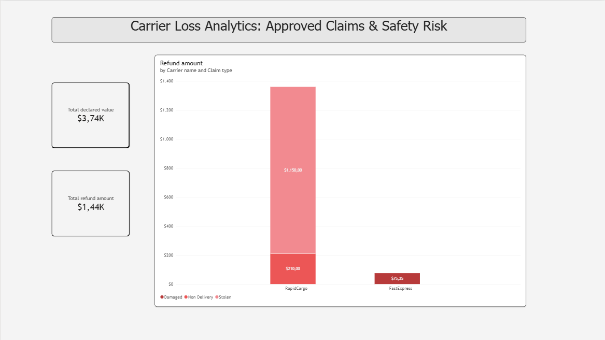

# 🚚 Carrier Loss Analytics: Approved Claims & Safety Risk

An executive-level Power BI dashboard built to audit logistic carrier performance, financial exposure, and claim loss patterns from Mercado Libre's Buyer Protection Program (BPP) data.

---

## 📌 Executive Summary & Key Findings

* **Total Financial Exposure:** $3,74K across declared order values.
* **Actual Reimbursed Loss:** $1,44K in approved claims.
* **Primary Risk Driver:** **RapidCargo** accounts for over **94% of total financial losses** ($1,360.00).
* **Root Cause Analysis:** **84.5% of RapidCargo's loss ($1,150.00)** is attributed to **Stolen** items during transit, signaling a major security breach in cargo custody rather than general packaging failure.
* **Secondary Logistics Performance:** **FastExpress** exhibited minimal impact ($75.25), restricted strictly to physical handling damage (*Damaged*).

---

## 🛠️ Data Model & Architecture

* **Star Schema Architecture:**
  * `orders` (Fact table) connected to `shipments` and `bpp_claims` via 1-to-Many relationships.
* **Cross-Filter Calibration:**
  * Enabled **Bidirectional Filtering (Both)** between `orders` and `shipments` to allow carrier-level filtering across all claims.
* **Key Business Logic:**
  * Claims filtered dynamically by `claim_status = 'Approved'` to measure real cash flow leakage.

---

## 🧰 Tech Stack

* **Power BI Desktop:** Star schema data modeling, cross-filtering, stacked column charts, KPI cards.
* **SQL:** Initial data extraction, aggregations, and data validation auditing.
* **GitHub:** Version control & portfolio showcase.